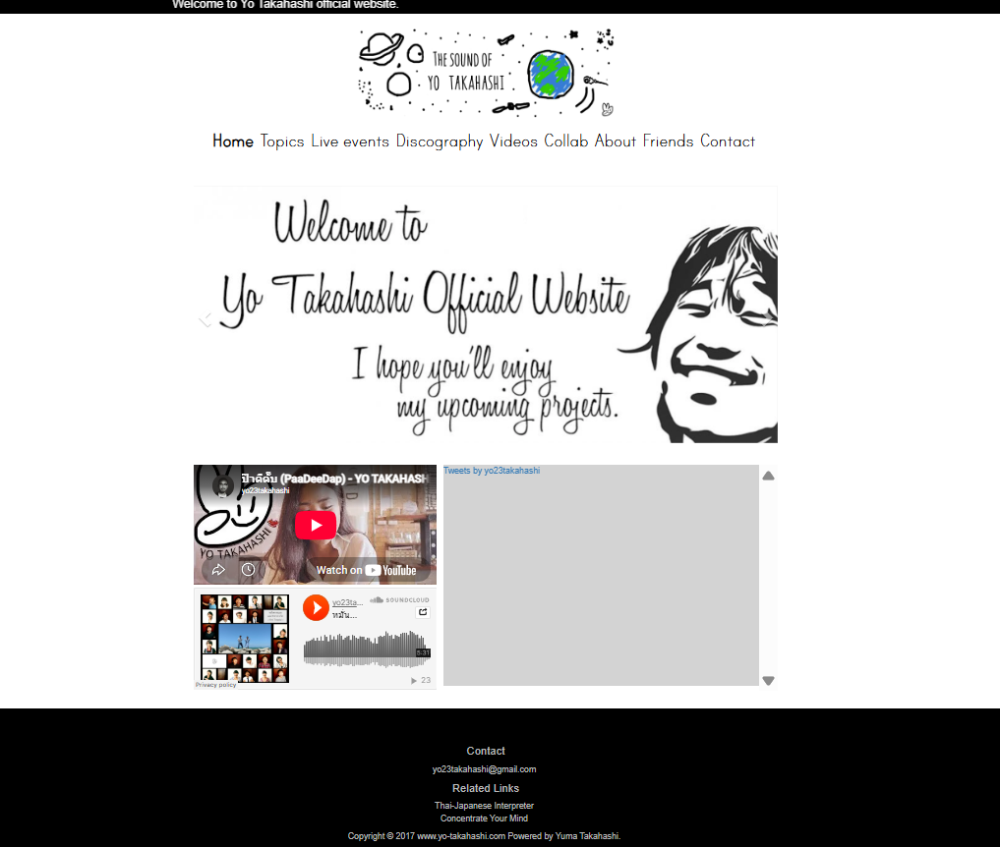
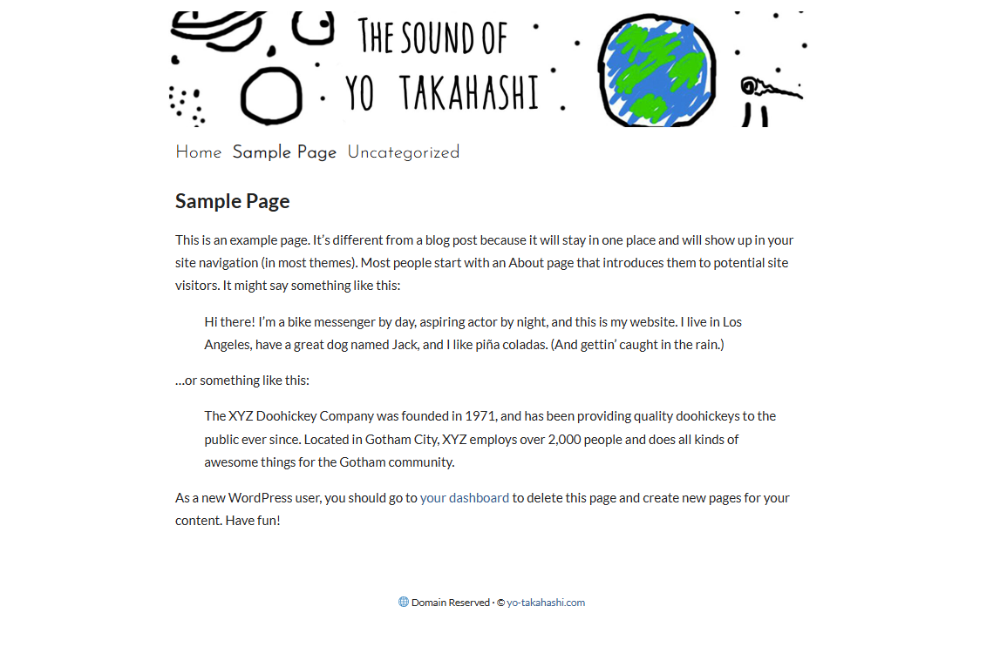

# Yo Takahashi WordPress Theme

A custom WordPress theme for [yo-takahashi.com](https://yo-takahashi.com/). that converts a legacy static PHP website into a CMS while preserving its original design.

I repurposed the website from a personal website into a domain landing page reserved for potential future sale.

## Design

**Previous Design**

**Current Design**

## Support

Please support my brother by checking out his personal website and projects: 
[yo23takahashi.com](https://yo23takahashi.com/).